<!-- Add your own links (remove the comment markers):

-->

 

<code>demonmj@github ~ $ ls ~/projects</code>

<table>
<tr>
<td width="50%" valign="top">

**[🚦 Bangalore-Traffic](https://github.com/demonmj/Bangalore-Traffic)** 
Data-driven traffic navigation for Bengaluru — real-time insights for route planning and urban mobility. 

</td>
<td width="50%" valign="top">

**[🕳️ Pothole_Detection](https://github.com/demonmj/Pothole_Detection)** 
YOLOv8 + OpenCV pipeline that detects potholes, rates severity, geotags them and plots results on a map. 

</td>
</tr>
</table>

<code>// stats refresh daily via GitHub Actions — <a href=".github/workflows/terminal-profile.yml">terminal-profile.yml</a></code>

